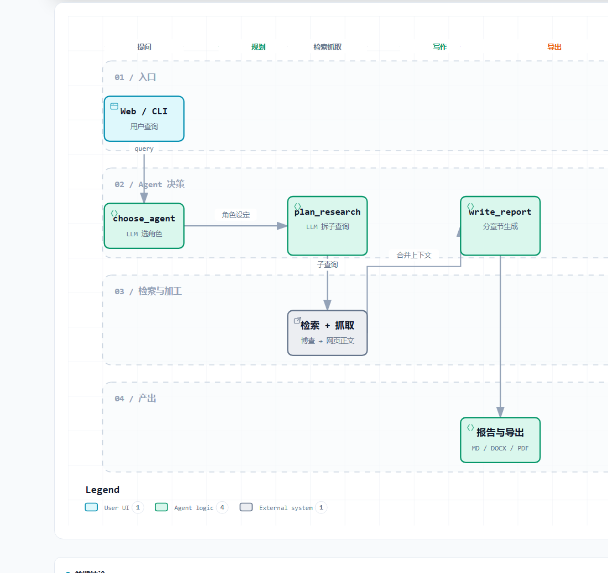
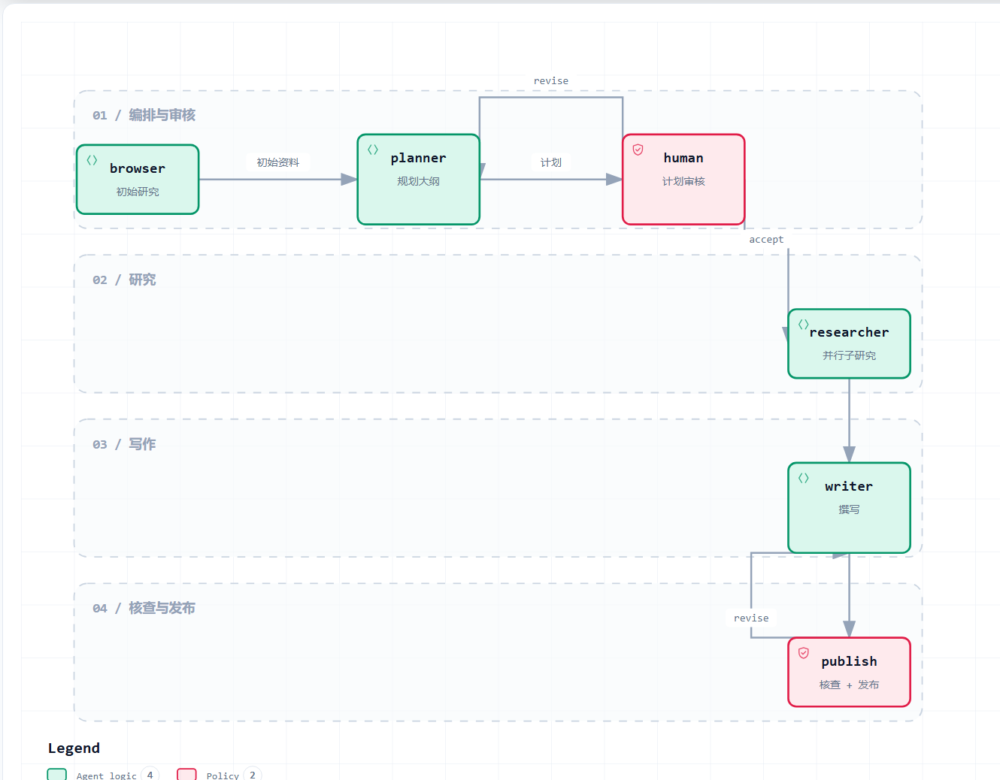

<div align="center">

# 🔎 GPT Researcher 中文版

**基于 [assafelovic/gpt-researcher](https://github.com/assafelovic/gpt-researcher) 的中文本地化版本**

开箱即用 · 阿里云百炼 + 博查搜索 · 中文界面 · 中文报告 · 规范 Word / PDF 导出

[上游项目](https://github.com/assafelovic/gpt-researcher) · [原始文档](https://docs.gptr.dev) · [问题反馈](https://github.com/jiuhao777/gpt-researcher-main-Chinese/issues)

</div>

---

## 📌 这是什么

本项目是 [GPT Researcher](https://github.com/assafelovic/gpt-researcher) 的**中文适配版**（仓库：`gpt-researcher-main-Chinese`）。

GPT Researcher 是一个开源的深度研究智能体：规划代理把研究任务拆成若干子问题，执行代理并行搜索、抓取和筛选资料，最后汇总成带引用的研究报告。

原版默认面向 OpenAI + Tavily，界面和报告都是英文。本仓库针对中国开发者的实际环境做了本地化改造：

- 不依赖 OpenAI / Tavily，改用**阿里云百炼（DashScope）** 与 **博查搜索（Bocha）**
- 前端界面、研究进度日志、最终报告**全中文**
- 报告导出为符合中文文档习惯的 **Word / PDF**（宋体小四、首行缩进、固定行距等）

> 如果你需要英文原版或最新上游功能，请直接使用[上游仓库](https://github.com/assafelovic/gpt-researcher)。

---

## 🗺️ 流程图

<table>
<tr>
<td width="46%"></td>
<td width="54%"></td>
</tr>
<tr>
<td align="center"><b>单 Agent 研究流水线</b><br><sub>默认的 research_report / detailed_report</sub></td>
<td align="center"><b>多智能体 LangGraph 状态图</b><br><sub>report_type=multi_agents</sub></td>
</tr>
</table>

### 两张图分别是什么

**左图：单 Agent 研究流水线**

入口 → 角色选择 → 子查询规划 → 检索抓取 → 合并上下文 → 分章节写作 → 报告导出。控制流写死在 `gpt_researcher/skills/researcher.py`，LLM 只在 4 个位置做决策（选角色、拆子查询、筛上下文、写报告）。

**右图：多智能体 LangGraph 状态图**

`browser → planner → human → researcher → writer → fact_checker → publisher`。其中 `human → planner`（计划返工）与 `publish → writer`（事实返工）是两个**有界循环**，上限分别由 `max_plan_revisions`、`max_fact_check_revisions` 控制，超限强制放行。图定义在 `multi_agents/agents/orchestrator.py`。

### 交互版怎么用

仓库同时提供可交互 HTML：

- [`diagrams/gptr-workflow.html`](diagrams/gptr-workflow.html)
- [`diagrams/gptr-multiagents.html`](diagrams/gptr-multiagents.html)

> GitHub 不会直接渲染 HTML。点击后在页面右上角点 **Download**，下载到本地用浏览器打开。

打开后可以：

| 操作 | 说明 |
|---|---|
| Light / Dark | 切换明暗主题 |
| 滚轮 / 右下角 ± | 缩放与平移 |
| **Guided views** | 顶部预设视角，如「LLM 决策点」「两个审核循环」，点击高亮对应节点 |
| **Search** | 按节点名搜索定位 |
| **Export** | 导出 PNG / SVG / WebP，可直接放进 PPT 或文档 |
| **Present** | 全屏演示模式 |

### 想改图

图由 `diagrams/*.json` 定义（泳道、节点、边、标签），改完后用 Archify CLI 重新生成：

```bash
archify render workflow diagrams/gptr-workflow.json diagrams/gptr-workflow.html
archify validate workflow diagrams/gptr-workflow.json --quality showcase
```

---

## ✨ 相对原项目的改动

### 1. 界面中文化

| 文件 | 改动 |
|---|---|
| `frontend/index.html` | 标题、标语、表单标签、报告类型/语气/来源下拉、MCP 配置区、按钮、进度区、历史面板、下载栏、页脚全部中文化，`lang="zh-CN"` |
| `frontend/scripts.js` | 82 处用户可见文案：连接状态、toast 提示、删除/清空确认框、历史面板、导入导出、语音输入（识别语言改为 `zh-CN`）、聊天欢迎语与断线提示、MCP 校验与说明弹窗 |
| `frontend/styles.css` | 历史面板按钮的伪元素文案 `History` → `研究历史` |
| `gpt_researcher/skills/*.py` | 18 条研究进度日志中文化（「开始研究任务」「正在规划研究策略」「已抓取 N 个网页」「报告已完成」等） |
| `.env` | `LANGUAGE=Simplified Chinese (简体中文)`，报告正文使用简体中文生成 |

### 2. 适配国内模型与搜索

- LLM 走项目内置的 `dashscope` provider（阿里云百炼 OpenAI 兼容接口）
- 默认模型：`qwen-flash`（快）、`qwen-plus`（主力）、`text-embedding-v3`（向量化）
- 检索器改为博查：`RETRIEVER=bocha`，读取环境变量 `BOCHA_API_KEY`
  - 注意：项目里博查 retriever 的变量名必须是 `BOCHA_API_KEY`，拼错会直接 `KeyError`
- 实测 `qwen-turbo` 在免费额度下容易返回 429，因此快模型改用 `qwen-flash`

### 3. 报告导出排版（Word / PDF）

`backend/utils.py` 与 `backend/styles/pdf_styles.css` 做了以下调整：

**Word（`.docx`）**

- 纸张 A4，页边距 **左 3cm、右 2.5cm**（上下 2.54cm）
- 正文中文 **宋体**，英文与数字 **Times New Roman**
- 正文 **小四（12pt）**，行距 **固定 20 磅**，字间距标准
- 正文段落 **首行缩进 2 字符**；标题、列表、引用、表格内段落不缩进
- 标题分级，不做统一字号：一级 16pt、二级 14pt、三级及以下 12pt，均加粗
- 自动去除报告开头的 YAML 元数据块（`task_id`、`query` 等），避免出现在正文第一段

**PDF（`.pdf`）**

- 原实现依赖 WeasyPrint + GTK3，Windows 上默认不可用
- 改为优先使用本机 **Edge / Chrome 无头打印**（`--headless=new --print-to-pdf`），失败才回退 WeasyPrint
- 排版规则与 Word 保持一致：A4、左 3cm 右 2.5cm、宋体 + Times New Roman、12pt、20 磅行距、首行缩进 2 字符

### 4. 新增自检脚本

- `selfcheck.py`：一键检查环境变量、Python 依赖、前端文件、百炼与博查连通性、端口占用情况
- 支持 `--offline` 只做本地检查，不发网络请求

---

## 🧩 环境要求

| 项目 | 要求 |
|---|---|
| Python | 3.12 及以上（开发与验证使用 3.13.5） |
| 操作系统 | Windows 10/11 已验证；Linux / macOS 理论可用 |
| 浏览器 | 导出 PDF 需要本机安装 Edge 或 Chrome |
| 网络 | 能访问 `dashscope.aliyuncs.com` 与 `api.bochaai.com` |

---

## 🚀 快速开始

### 1. 获取代码

```bash
git clone https://github.com/jiuhao777/gpt-researcher-main-Chinese.git
cd gpt-researcher-main-Chinese
```

### 2. 安装依赖

**Windows（PowerShell）**

```powershell
python -m venv .venv
.\.venv\Scripts\Activate.ps1
python -m pip install -r requirements.txt -i https://pypi.tuna.tsinghua.edu.cn/simple
python -m pip install dashscope -i https://pypi.tuna.tsinghua.edu.cn/simple
```

> `dashscope` 是向量化模型需要的 SDK，`requirements.txt` 未包含，需要单独安装。

**Linux / macOS**

```bash
python3 -m venv .venv
source .venv/bin/activate
pip install -r requirements.txt
pip install dashscope
```

### 3. 配置 Key

复制环境变量模板：

```bash
cp .env.example .env     # Windows: copy .env.example .env
```

然后编辑 `.env`，填写下面**两个** Key：

#### ① 阿里云百炼 API Key（大模型 + 向量化）

1. 打开 [阿里云百炼控制台](https://bailian.console.aliyun.com/)
2. 右上角进入「API-KEY」管理，创建一个 API Key
3. 填入 `.env` 的 `DASHSCOPE_API_KEY`

```ini
DASHSCOPE_API_KEY=sk-你的百炼Key
```

#### ② 博查 API Key（网页搜索）

1. 打开 [博查开放平台](https://open.bochaai.com/) 注册并创建 API Key
2. 填入 `.env` 的 `BOCHA_API_KEY`

```ini
BOCHA_API_KEY=sk-你的博查Key
```

> 本项目不再需要 `OPENAI_API_KEY` 和 `TAVILY_API_KEY`。

### 4. 启动

```powershell
cd gpt-researcher-main-Chinese
.\.venv\Scripts\python.exe -m uvicorn main:app --host 127.0.0.1 --port 8000
```

浏览器打开 <http://127.0.0.1:8000>，输入问题、选择报告类型与语气，点「开始研究」。

按 `Ctrl+C` 停止服务。

### 5. 验证

```powershell
.\.venv\Scripts\python.exe selfcheck.py
```

预期输出最后一行：

```
结果：19 项通过，0 项失败
```

---

## 🔄 切换模型供应商

项目内置 `provider_setup.py`，一条命令即可切换到 DeepSeek、千问、Kimi、智谱等供应商，不用手改 `.env`。

### 支持的供应商

| 名称 | 说明 | Key 环境变量 | 向量化 |
|---|---|---|---|
| `dashscope`（别名 `qwen`） | 阿里云百炼 / 通义千问 | `DASHSCOPE_API_KEY` | ✅ |
| `deepseek` | DeepSeek | `DEEPSEEK_API_KEY` | ❌ 自动降级 keyword |
| `openai` | OpenAI 官方 | `OPENAI_API_KEY` | ✅ |
| `moonshot`（别名 `kimi`） | 月之暗面 | `OPENAI_API_KEY` + base | ❌ |
| `zhipu`（别名 `glm`） | 智谱 GLM | `OPENAI_API_KEY` + base | ✅ |
| `minimax` | MiniMax | `MINIMAX_API_KEY` | ❌ |
| `siliconflow` | 硅基流动 | `OPENAI_API_KEY` + base | ✅ |
| `volcengine`（别名 `doubao` / `ark`） | 火山方舟（豆包） | `OPENAI_API_KEY` + base | ❌ |
| `openrouter` | OpenRouter | `OPENROUTER_API_KEY` | ❌ |
| `groq` | Groq | `GROQ_API_KEY` | ❌ |
| `ollama` | 本地 Ollama | 无需 Key | ✅ |

### 用法

```powershell
# 交互式选择（推荐）
.\.venv\Scripts\python.exe provider_setup.py

# 直接指定供应商
.\.venv\Scripts\python.exe provider_setup.py --provider deepseek --key sk-xxxx

# 切换并立即验证连通性
.\.venv\Scripts\python.exe provider_setup.py --provider qwen --key sk-xxxx --check

# 只预览会写入什么，不修改 .env
.\.venv\Scripts\python.exe provider_setup.py --provider kimi --key sk-xxxx --dry-run

# 查看全部供应商
.\.venv\Scripts\python.exe provider_setup.py --list
```

脚本只维护 `.env` 里 `# >>> provider config` 标记块，不会改动 `RETRIEVER`、`LANGUAGE` 等其他配置。切换后重启服务生效。

### 手动配置示例

DeepSeek（无 embedding，自动降级关键词过滤）：

```ini
DEEPSEEK_API_KEY=sk-你的DeepSeekKey
FAST_LLM=deepseek:deepseek-chat
SMART_LLM=deepseek:deepseek-chat
STRATEGIC_LLM=deepseek:deepseek-chat
CONTEXT_FILTER=keyword
```

Kimi / Moonshot（OpenAI 兼容）：

```ini
OPENAI_API_KEY=sk-你的MoonshotKey
OPENAI_BASE_URL=https://api.moonshot.cn/v1
FAST_LLM=openai:moonshot-v1-8k
SMART_LLM=openai:moonshot-v1-32k
STRATEGIC_LLM=openai:moonshot-v1-32k
CONTEXT_FILTER=keyword
```

智谱 GLM：

```ini
OPENAI_API_KEY=你的智谱Key
OPENAI_BASE_URL=https://open.bigmodel.cn/api/paas/v4
FAST_LLM=openai:glm-4-flash
SMART_LLM=openai:glm-4-plus
STRATEGIC_LLM=openai:glm-4-plus
EMBEDDING=openai:embedding-3
```

> DeepSeek、Kimi、火山方舟等没有 embedding 接口，脚本会自动把 `CONTEXT_FILTER` 设为 `keyword`（用关键词排序代替向量检索），报告仍可正常生成，只是上下文筛选策略不同。如果你同时有百炼或 OpenAI 的 Key，把 `EMBEDDING` 指过去即可恢复向量筛选。

### 常见供应商 Key 获取地址

| 供应商 | 地址 |
|---|---|
| 阿里云百炼 | https://bailian.console.aliyun.com/ |
| DeepSeek | https://platform.deepseek.com/api_keys |
| 月之暗面 | https://platform.moonshot.cn/console/api-keys |
| 智谱 | https://open.bigmodel.cn/usercenter/apikeys |
| 硅基流动 | https://cloud.siliconflow.cn/account/ak |
| 火山方舟 | https://console.volcengine.com/ark |
| OpenRouter | https://openrouter.ai/keys |
| Groq | https://console.groq.com/keys |
| 博查 | https://open.bochaai.com/ |

## ⚙️ `.env` 配置说明

一个可用的最小配置如下（**请替换为你自己的 Key**）：

```ini
# 模型与 Key
DASHSCOPE_API_KEY=sk-你的百炼Key
BOCHA_API_KEY=sk-你的博查Key

# 模型：dashscope 为项目内置 provider
FAST_LLM=dashscope:qwen-flash
SMART_LLM=dashscope:qwen-plus
STRATEGIC_LLM=dashscope:qwen-plus

# 输出 token 上限（百炼模型单次输出一般 8k，压到 6k 以内更稳）
FAST_TOKEN_LIMIT=3000
SMART_TOKEN_LIMIT=6000
STRATEGIC_TOKEN_LIMIT=4000

# 向量化模型
EMBEDDING=dashscope:text-embedding-v3

# 检索器与本地文档目录
RETRIEVER=bocha
DOC_PATH=./my-docs

# 报告语言
LANGUAGE=Simplified Chinese (简体中文)

# 关闭报告内嵌图片（需要 Google Key）
IMAGE_GENERATION_ENABLED=false
```

| 变量 | 作用 | 建议值 |
|---|---|---|
| `DASHSCOPE_API_KEY` | 百炼 Key，模型与向量化共用 | 必填 |
| `BOCHA_API_KEY` | 博查 Key，变量名不可拼错 | 必填 |
| `FAST_LLM` | 快速任务模型 | `dashscope:qwen-flash` |
| `SMART_LLM` | 报告撰写模型 | `dashscope:qwen-plus` |
| `STRATEGIC_LLM` | 规划模型 | `dashscope:qwen-plus` |
| `EMBEDDING` | 向量化模型 | `dashscope:text-embedding-v3` |
| `RETRIEVER` | 搜索源 | `bocha` |
| `LANGUAGE` | 报告语言 | `Simplified Chinese (简体中文)` |
| `DOC_PATH` | 「我的文档」模式读取的目录 | `./my-docs` |

> ⚠️ 修改 `.env` 后必须重启服务才会生效。`.env` 已加入 `.gitignore`，不会被提交。

---

## 🖥 使用方式

### Web 界面

启动后访问 <http://127.0.0.1:8000>：

- 报告类型：摘要 / 详细报告 / 资源清单 / 深度研究
- 语气：客观、正式、分析、说服等 15 种
- 来源：互联网 / 我的文档 / 混合 / Azure 存储
- 研究过程中右侧实时显示中文进度日志
- 完成后可下载 Markdown、Word、PDF，也可就报告继续对话

### 命令行

```powershell
.\.venv\Scripts\python.exe cli.py "2026 年 AI Agent 的主要技术趋势" --report_type research_report
```

报告输出到 `outputs/` 目录（Markdown + Word + PDF）。

### 自检

```powershell
.\.venv\Scripts\python.exe selfcheck.py            # 全量检查（含网络请求）
.\.venv\Scripts\python.exe selfcheck.py --offline  # 只检查配置与依赖
```

---

## 📄 报告导出格式

| 格式 | 说明 |
|---|---|
| Markdown | 原始报告，含引用链接 |
| Word | A4；宋体小四 + Times New Roman；固定 20 磅行距；左 3cm 右 2.5cm；正文首行缩进 2 字符；标题分级加粗 |
| PDF | 与 Word 同排版规则，由无头 Edge/Chrome 渲染，无页眉页脚 |

文件位于 `outputs/`，命名格式为 `task_<时间戳>_<问题摘要>.md/.docx/.pdf`。

---

## ❓ 常见问题

**Q：启动报 `[Errno 10048]` 端口被占用**

```powershell
netstat -ano | findstr :8000
taskkill /PID <上面的PID> /F
```

**Q：研究时报 401**

Key 没填对或没生效。检查 `.env` 的 `DASHSCOPE_API_KEY`、`BOCHA_API_KEY`，修改后重启服务。

**Q：研究时报 429**

百炼限流或免费额度用尽。把 `FAST_LLM` 换成 `qwen-flash`，或稍后重试、在百炼控制台确认额度。

**Q：博查搜索报 `KeyError: 'BOCHA_API_KEY'`**

`.env` 里变量名拼错了（例如写成 `BOCHA_API_KYE`），改成 `BOCHA_API_KEY`。

**Q：PDF 没有生成**

需要本机安装 Edge 或 Chrome。终端若出现 `Error in browser PDF rendering`，请把报错贴到 issue。

**Q：页面还是英文**

浏览器缓存，按 `Ctrl+F5` 强制刷新。

**Q：报告是英文**

检查 `.env` 的 `LANGUAGE`，修改后重启服务。

---

## 📁 目录结构

```
gpt-researcher-main-Chinese/
├── backend/                 # FastAPI 后端、Word/PDF 导出
│   ├── server/app.py
│   ├── utils.py             # 报告导出（排版规则在这里）
│   └── styles/pdf_styles.css
├── frontend/                # 原生 HTML/CSS/JS 前端（已中文化）
│   ├── index.html
│   ├── scripts.js
│   └── styles.css
├── gpt_researcher/          # 智能体核心（规划、检索、抓取、撰写）
│   ├── agent.py
│   ├── skills/              # 研究技能（日志已中文化）
│   └── retrievers/          # 搜索源实现（含 bocha）
├── multi_agents/            # LangGraph 多智能体
├── docs/                    # 文档站点
├── cli.py                   # 命令行入口
├── main.py                  # Web 服务入口
├── selfcheck.py             # 自检脚本
├── requirements.txt
└── .env.example             # 配置模板（无真实密钥）
```

---

## 🙏 致谢与许可证

- 上游项目：[assafelovic/gpt-researcher](https://github.com/assafelovic/gpt-researcher)
- 本项目遵循上游 **MIT License**，详见 [LICENSE](LICENSE)
- 中文适配、百炼/博查接入、报告排版与中文化改动由本仓库维护者完成

> 本仓库**不包含任何真实 API Key**。`.env` 已被 `.gitignore` 忽略，请勿提交自己的密钥。